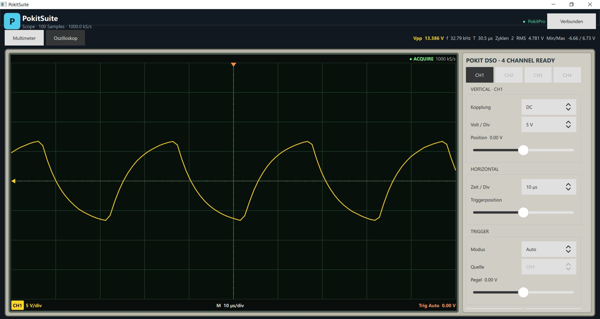

# PokitSuite

[](https://github.com/robertbuss85-stack/PokitSuite/actions/workflows/ci.yml)
[](https://github.com/robertbuss85-stack/PokitSuite/actions/workflows/pages.yml)
[](LICENSE)

PokitSuite is a native Windows measurement application for Pokit Pro Bluetooth instruments. It combines a live digital multimeter,  digital storage oscilloscope, signal metrics, and an MCP interface for AI-assisted measurement and Arduino workflows.

> PokitSuite was developed with substantial assistance from **OpenAI Codex**, directed and tested against real Pokit Pro hardware by the project owner.

[Website](https://robertbuss85-stack.github.io/PokitSuite/) · [Download](https://github.com/robertbuss85-stack/PokitSuite/releases/latest) · [German documentation](docs/README.de.md) · [MCP guide](docs/MCP.md)



## Current status

| Area | Status | Notes |
|---|---|---|
| Pokit Pro discovery and BLE reconnect | Implemented, hardware-tested | Automatic reconnect, watchdogs, feature activation and wake traffic |
| Digital multimeter | Implemented, hardware-tested | Automatic start, modes, 0.5 s / 1 s intervals, scrolling time-value history |
| One-channel DSO | Implemented, hardware-tested | Continuous/single acquisition, coupling, V/div, time/div, trigger mode/level/position |
| Signal metrics | Implemented, hardware-tested | Min, max, mean, RMS, Vpp, frequency, period, cycles and duty cycle |
| MCP measurement tools | Implemented, protocol-tested | 17 tools over stdio; live values require a running native app |
| Arduino edit/compile/upload loop | Experimental | Backup-aware edits and CLI integration; board/FQBN and physical target remain user-dependent |
| Four-channel UI | Planned | UI anticipates four instruments; only CH1 is currently operational |
| Native logger workspace | Planned | DMM history is available; a dedicated long-duration logger UI is not yet native |
| Legacy browser UI | Experimental/legacy | Retained for compatibility; native Qt application is the supported frontend |

## Quick start

1. Download `PokitSuite-Windows-x64.zip` from the latest release.
2. Extract the complete archive.
3. Ensure Bluetooth is enabled and the Pokit Pro is awake.
4. Run `PokitSuiteNative.exe`; the active measurement page starts automatically after connection.

Windows 10/11 x64 and a Bluetooth Low Energy adapter are required. Pokit Pro is the tested device. Pokit Meter support exists in the underlying Dokit library but has not yet been validated in PokitSuite.

## Build from source

Requirements: CMake 3.21+, Ninja or Visual Studio, MSVC with C++17, and Qt 6.8+ with Core, GUI, QML, Quick, Quick Controls 2 and Bluetooth.

```powershell
cmake -S native -B native/build -G Ninja `
  -DCMAKE_PREFIX_PATH=C:/Qt/6.8.3/msvc2022_64 `
  -DCMAKE_BUILD_TYPE=Release
cmake --build native/build
```

The vendored QtPokit/Dokit sources are compiled as part of the build; no private prebuilt library is required. See [Installation](docs/INSTALL.md), [Development](docs/DEVELOPMENT.md), and [Testing](docs/TESTING.md).

## MCP and AI workflows

The included MCP server exposes live device state, DMM readings, complete scope frames and metrics, scope configuration/capture controls, Arduino sketch discovery/editing, Arduino CLI compilation/upload, serial monitoring, and backup restoration.

```json
{
  "mcpServers": {
    "pokitsuite": {
      "command": "python",
      "args": ["C:\\path\\to\\PokitSuite\\mcp\\pokitsuite_mcp.py"]
    }
  }
}
```

The AI/Arduino loop is deliberately tool-based: an agent can inspect a measured frame, compare it with limits, propose a narrowly scoped edit, compile, upload, and re-measure. Uploading firmware changes connected hardware and must be supervised. Full configuration and examples are in [docs/MCP.md](docs/MCP.md).

## Project layout

- `native/` — C++17/Qt Quick application and vendored Dokit source
- `mcp/` — Python MCP server and live telemetry bridge
- `tests/` — offline protocol/contract tests
- `site/` — GitHub Pages source
- `PokitSuite.py` / `PokitSuite.html` — retained legacy web implementation

## License and trademarks

PokitSuite is licensed under [GPL-3.0-or-later](LICENSE). Vendored Dokit/QtPokit remains LGPL-3.0-or-later; see [Third-party notices](THIRD_PARTY_NOTICES.md). “Pokit” is a trademark of Pokit Innovations. This independent project is not affiliated with or endorsed by Pokit Innovations, Tektronix, or OpenAI.

