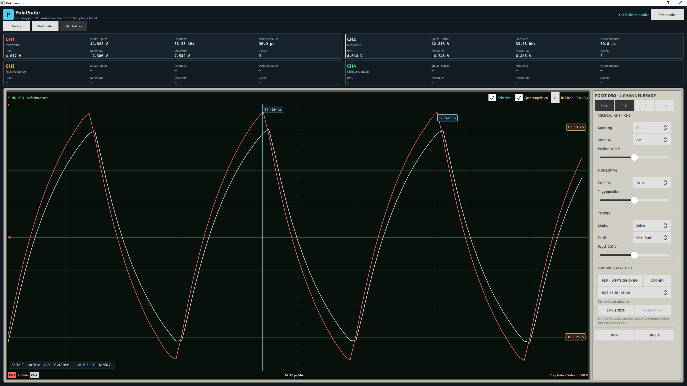

# PokitSuite

[](https://github.com/robertbuss85-stack/PokitSuite/actions/workflows/ci.yml)
[](https://github.com/robertbuss85-stack/PokitSuite/actions/workflows/pages.yml)
[](LICENSE)

PokitSuite is a native Windows measurement application for Pokit Pro Bluetooth instruments. It combines a dual-device digital multimeter, a two-channel digital storage oscilloscope with native radio-triggered acquisitions, signal metrics, and an MCP interface for AI-assisted measurement and Arduino workflows.

**Technology:** The supported desktop application is written in **C++17 with Qt/QML**. Python is used only for the companion MCP server and the retained experimental legacy web fallback.

> PokitSuite was developed with substantial assistance from **OpenAI Codex**, directed and tested against real Pokit Pro hardware by the project owner.

[Website](https://robertbuss85-stack.github.io/PokitSuite/) · [Download](https://github.com/robertbuss85-stack/PokitSuite/releases/latest) · [German documentation](docs/README.de.md) · [MCP guide](docs/MCP.md)



## Current status

| Area | Status | Notes |
|---|---|---|
| Pokit Pro discovery and BLE reconnect | Implemented, hardware-tested | Automatic reconnect, watchdogs, feature activation and wake traffic |
| Dual-device digital multimeter | Implemented, live DC voltage tested on two Pokit Pro devices | Automatic discovery, independent BLE watchdogs, 0.5 s / 1 s intervals and two live histories |
| Two-channel DSO | Implemented, acquisition tested on two Pokit Pro devices | Concurrent CH1/CH2 acquisition, continuous/single acquisition, coupling, V/div, time/div and trigger controls |
| Native radio trigger | Implemented, live acquisition tested | CH1 or CH2 as trigger master, RUN/STOP/SINGLE, 100–1,000 samples per channel and alignment using device trigger metadata. Absolute timing accuracy remains unmeasured. |
| Signal metrics | Implemented, hardware-tested | Min, max, mean, RMS, Vpp, frequency, period, cycles and duty cycle |
| Capture reports and comparison curves | Implemented, hardware-tested | PDF report, CSV value table, JSON waveform archive and selectable overlay |
| Time and voltage cursors | Implemented, UI-tested | Drag two cursors per axis; read trigger-relative time, voltage, Δt, ΔU and 1/\|Δt\|; independent visibility and reset |
| MCP measurement tools | Implemented, protocol-tested | 17 tools over stdio; live values require a running native app |
| Arduino edit/compile/upload loop | Experimental | Backup-aware edits and CLI integration; board/FQBN and physical target remain user-dependent |
| Four-channel UI | Experimental | CH1 and CH2 are operational; CH3 and CH4 remain planned |
| Native DMM statistics and recording | Implemented, offline-tested; short two-device DC voltage check | HOLD/REL, min/max/mean, limits, timestamped zoom/pan, comments, streaming CSV and PDF summaries; multi-day validation pending. [Guide](docs/MULTIMETER.md) |
| Legacy browser UI | Experimental/legacy | Retained for compatibility; native Qt application is the supported frontend |

## Quick start

1. Download `PokitSuite-Windows-x64.zip` from the latest release.
2. Extract the complete archive.
3. Ensure Bluetooth is enabled and the Pokit Pro is awake.
4. Run `PokitSuiteNative.exe`; the active measurement page starts automatically after connection.

Windows 10/11 x64 and a Bluetooth Low Energy adapter are required. Pokit Pro is the tested device. Pokit Meter support exists in the underlying Dokit library but has not yet been validated in PokitSuite.

## Radio-triggered two-channel capture

Connect two Pokit Pro devices and open **Oszilloskop**. In **TRIGGER → Quelle**, select **CH1 · Funk** or **CH2 · Funk**. Choose **Sofort** for immediate capture. Press **RUN** for repeated paired acquisitions, **STOP** to stop, or **SINGLE** for one pair. Radio capture supports **10 µs/div**, with 100, 200 and 500 samples per channel at 10, 20 and 50 µs/div respectively, and 1,000 samples at longer timebases.

Changing volts/div or time/div during RUN applies the new settings to the next acquisition without stopping RUN. Incomplete transfers are retried using the device's resend command. Rising/falling trigger capture remains under investigation following intermittent missing acquisitions.

PokitSuite arms the follower, waits for the acknowledged settings write, and then arms the master. Each acquisition uses a fresh radio group. Both complete records must report the expected roles, group and matching acquisition number before the app displays the pair. Curves use each device's sample rate and trigger sample on a common trigger axis.

Live tests passed with either device as the master, repeated immediate captures, a rising-edge capture with trigger sample 500 on both devices, and stop/re-arm. A shared reference signal is still needed to measure channel skew and jitter and establish the usable speed range for an A/B encoder. The test procedure is in [Testing](docs/TESTING.md).

## Build from source

Requirements: CMake 3.21+, Ninja or Visual Studio, MSVC with C++17, and Qt 6.8+ with Core, GUI, QML, Quick, Quick Controls 2 and Bluetooth.

```powershell
cmake -S native -B native/build -G Ninja `
  -DCMAKE_PREFIX_PATH=C:/Qt/6.8.3/msvc2022_64 `
  -DCMAKE_BUILD_TYPE=Release
cmake --build native/build
```

The vendored QtPokit/Dokit sources are compiled as part of the build; no private prebuilt library is required. See [Installation](docs/INSTALL.md), [Development](docs/DEVELOPMENT.md), and [Testing](docs/TESTING.md).

## MCP and AI workflows

The included MCP server exposes live device state, DMM readings, complete scope frames and metrics, scope configuration/capture controls, Arduino sketch discovery/editing, Arduino CLI compilation/upload, serial monitoring, and backup restoration.

```json
{
  "mcpServers": {
    "pokitsuite": {
      "command": "python",
      "args": ["C:\\path\\to\\PokitSuite\\mcp\\pokitsuite_mcp.py"]
    }
  }
}
```

The AI/Arduino loop is deliberately tool-based: an agent can inspect a measured frame, compare it with limits, propose a narrowly scoped edit, compile, upload, and re-measure. Uploading firmware changes connected hardware and must be supervised. Full configuration and examples are in [docs/MCP.md](docs/MCP.md).

## Project layout

- `native/` — C++17/Qt Quick application and vendored Dokit source
- `mcp/` — Python MCP server and live telemetry bridge
- `tests/` — offline protocol/contract tests
- `site/` — GitHub Pages source
- `PokitSuite.py` / `PokitSuite.html` — retained legacy web implementation

## License and trademarks

PokitSuite is licensed under [GPL-3.0-or-later](LICENSE). Vendored Dokit/QtPokit remains LGPL-3.0-or-later; see [Third-party notices](THIRD_PARTY_NOTICES.md). “Pokit” is a trademark of Pokit Innovations. This independent project is not affiliated with or endorsed by Pokit Innovations, Tektronix, or OpenAI.

